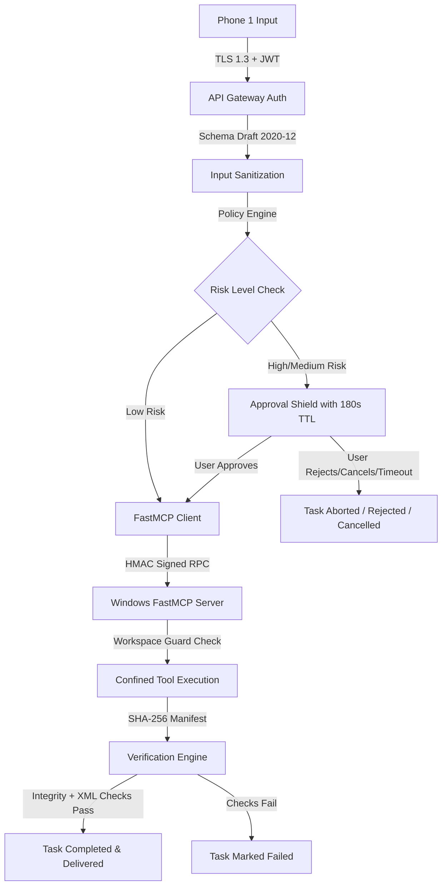

# Security Architecture & Approval Governance

- **Document ID**: `MIRA-DOC-SEC-011`
- **Revision**: 1.1.0
- **Status**: Core Security Specification
- **Last Updated**: 2026-10-18

---

## 1. Security Philosophy & Threat Model

MIRA is built on the tenet of **Defensive Agentic Governance**. Allowing an AI assistant to execute tools on a personal or enterprise Windows workstation introduces significant threat vectors:

1. **Prompt Injection & Indirect Jailbreaks**: A prompt attempting to trick an LLM into running destructive shell commands.
2. **Autonomous Tool Overreach**: An agent taking unauthorized consequential actions (e.g. deleting files, installing unapproved binaries).
3. **Data Exfiltration**: Malicious extraction of private documents or user credentials.
4. **Mobile Client Compromise**: Unauthorized devices attempting to control the workstation.

---

## 2. Six Inviolable Safety Invariants

The MIRA platform enforces six foundational safety rules that cannot be bypassed:

### Invariant 1: Zero Unrestricted Workstation Filesystem Access
Phone 1 is **strictly forbidden from browsing or querying the raw Windows filesystem**. All file interactions are strictly mediated through isolated, pre-registered tools confined to:
$$\text{WORKSPACE\_ROOT} = \texttt{C:\textbackslash mira\textbackslash workspace\textbackslash}$$
Path traversal sequences (`..`, absolute paths like `C:\Windows`) are rejected at the parameter validation boundary by the **Workspace Guard**.

### Invariant 2: Mandatory Consequential Action Gating
Any tool that alters system state, writes persistent files outside temporary folders, or runs external scripts is classified as **Consequential**. Consequential actions **cannot execute** without explicit, cryptographic approval issued by the user on Phone 1.

### Invariant 3: Strict Time-To-Live (TTL) on Approvals
Approval tickets carry an immutable expiration timestamp (default: 180 seconds, absolute maximum: 300 seconds). Once expired, the ticket is permanently dead, and any delayed execution attempt is blocked. Users may also explicitly cancel or deny the request on Phone 1.

### Invariant 4: No Blind Success Acknowledgment
A task is **never marked successful** merely because an LLM or an MCP tool returns an HTTP 200 or a success string. The task remains uncompleted until the physical output file is downloaded, cryptographically hashed, structurally validated, and registered by the **Verification Engine**.

### Invariant 5: Zero Persistent Screen or Camera Streaming
To guarantee personal privacy:
- MIRA does **not** capture, record, or persist live video or audio streams from the user's workstation or phone.
- Discrete, user-requested output files (such as an SVG poster or export summary) are the **only** persistent visual assets produced.

### Invariant 6: Strict Data Retention & Right-to-Forget
Requested output files are governed by transparent retention tiers (`ephemeral_1_hour`, `standard_7_days`, `permanent_archive`). When an artifact expires or is deleted by the user, both the container cache and the workstation workspace scratch copies are cryptographically purged.

---

## 3. Risk Tiers & Authorization Matrix

| Risk Tier | Criteria | Tools | Enforcement Mechanism |
| :--- | :--- | :--- | :--- |
| **Low** | Read-only queries, generation of temporary SVG vectors in sandbox. | `generate_svg_poster`, `export_telemetry`, `build_document` | Auto-cleared by policy engine; logged to audit trail. |
| **Medium** | Writing persistent files into user project folders, exporting bulk summaries. | `export_project_archive`, `update_workspace_notes` | **Mandatory Phone 1 Approval (TTL: 300s)** |
| **High** | Executing custom scripts, installing sandboxed dependencies, external network calls. | `run_sandboxed_script` | **Mandatory Phone 1 Approval with biometric / PIN re-auth (TTL: 180s)** |
| **Critical** | Deleting system files, modifying registry, raw command injection. | None (blocked by architecture) | **Hard System Block**; rejected at validation layer. |

---

## 4. Cryptographic Approval Ticket Enforcement

When an action requires approval, the backend creates a record conforming to `schemas/approval.schema.json`:
- **Unique Ticket UUID**: Tied to a single specific `task_id`, `user_id`, and requesting `device_id` (Phone 1).
- **Parameter Snapshot**: Captures the exact, immutable arguments passed to the tool.
- **One-Time Use Token**: Once consumed by the MCP Client, the ticket is marked `used` and cannot be replayed.
- **Instant Revocation & Cancellation**: If the user clicks "Deny" or "Cancel" on Phone 1, the ticket status updates immediately to `rejected` or `revoked`, and the task transitions to `rejected` or `cancelled`.

---

## 5. Defense-in-Depth Layer Summary

