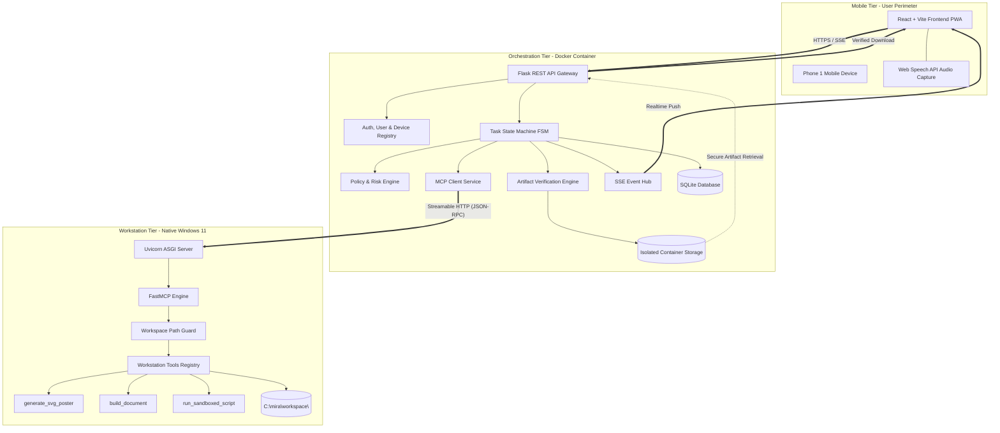

# System Architecture Specification

- **Document ID**: `MIRA-DOC-ARC-006`
- **Revision**: 1.1.0
- **Status**: Core Architecture Standard
- **Last Updated**: 2026-10-18

---

## 1. High-Level Architectural Topology

MIRA is organized around a clean three-tier architecture: the Mobile Client (**Phone 1**), the Central Orchestrator (**Flask Backend & MCP Client**), and the Workstation Host (**Windows Laptop FastMCP Server**).



---

## 2. Component Responsibilities

### A. Phone 1 (Primary Mobile Client)
- Captures spoken voice or typed prompt.
- Renders the confirmation card with the parsed task intent.
- Provides a dedicated, countdown-gated dialog for consequential tool approvals.
- Subscribes to the Server-Sent Events (SSE) telemetry stream.
- Renders the verified vector SVG poster with zoom/pan and provides single-tap download.
- **Strict Architecture Rule**: Phone 1 is the sole mobile interface and communicates exclusively with the Flask backend. It has no direct socket or IP connection to the Windows laptop, and no companion phone relay exists.

### B. MIRA Backend (Dockerized Flask Orchestrator & MCP Client)
- **API Blueprints**: Modular route handlers for tasks, approvals, artifacts, authentication, and events.
- **State Machine**: Transitions tasks through strict states (`pending_confirmation` -> `confirmed` -> `validating` -> `awaiting_approval` -> `approved` -> `executing` -> `verifying` -> `completed`, with abort/cancellation paths).
- **Policy Engine**: Assesses tool risk levels (Low, Medium, High). Intercepts consequential commands and generates approval records tied to both `user_id` and `requested_by_device_id`.
- **MCP Client**: Establishes session with FastMCP server using modern Streamable HTTP / SSE transport (targeting MCP `2025-11-25` or later); discovers tools via `tools/list`; dispatches invocations via `tools/call`.
- **Verification Engine**: Downloads laptop outputs into isolated container storage and executes structural and cryptographic checks.
- **SQLite Database**: Persists all entities using WAL mode for high concurrency.

### C. Windows Laptop MCP Server (FastMCP on Windows 11)
- Runs natively on the user's host Windows machine to leverage native CPU/GPU hardware, installed software packages, and system capabilities.
- Hosted using Uvicorn serving FastMCP endpoints over Streamable HTTP.
- **Workspace Guard**: Confines all disk writes to a single dedicated directory (`C:\mira\workspace\`). Rejects path traversal attempts (`..`, absolute drive changes).
- Produces physical output files with calculated SHA-256 digests.

---

## 3. Trust Boundaries & Security Enclaves

```
+-------------------------------------------------------------------------------+
| TRUST BOUNDARY 1: Mobile Network                                              |
| - Phone 1 operates outside the local trusted network.                         |
| - Encrypted with TLS 1.3; authenticated via Bearer JWT with scoped claims.    |
+-------------------------------------------------------------------------------+
                                       |
                                       v
+-------------------------------------------------------------------------------+
| TRUST BOUNDARY 2: Backend Container Perimeter                                 |
| - Backend container is isolated from the host OS via Docker namespaces.       |
| - Only exposed ports: 5000 (Backend API).                                     |
| - Storage volume mounted only to `storage/artifacts/`.                        |
+-------------------------------------------------------------------------------+
                                       |
                                       v
+-------------------------------------------------------------------------------+
| TRUST BOUNDARY 3: Workstation Host Perimeter                                  |
| - Windows FastMCP server listens on internal interface (or WireGuard VPN).   |
| - Mutual PSK / HMAC request signature authentication.                         |
| - Workspace Guard prohibits touching user system files, AppData, or Windows.  |
+-------------------------------------------------------------------------------+
```

---

## 4. End-to-End Data Flow Sequence

1. **Submission**: User on Phone 1 speaks *"Generate an event poster for AI Summit 2026"*. Phone 1 sends POST to `/api/tasks`.
2. **Confirmation**: Backend parses intent, creates task `c1a9...` in `pending_confirmation`, returns summary to Phone 1. Phone 1 displays confirmation button.
3. **User Consent**: User taps "Confirm". Task state becomes `confirmed`, then `validating`.
4. **Gating**: Policy engine verifies tool `generate_svg_poster`. Since this is a safe, sandboxed generation tool, it qualifies as `low` risk (no approval required).
5. **MCP Dispatch**: MCP Client invokes `generate_svg_poster` on Windows FastMCP via Streamable HTTP.
6. **Execution & Progress**: FastMCP generates vector nodes and writes `ai_summit_2026.svg` to `C:\mira\workspace\tasks\c1a9...`. Progress events stream over SSE to Phone 1.
7. **Production & Hashing**: FastMCP computes SHA-256 of the generated SVG and returns execution manifest to backend. Task moves to `verifying`.
8. **Verification Gate**: Backend pulls file into container storage, re-computes SHA-256 (matches), and parses XML tree (checks valid `<svg>` tag, viewBox, and absence of scripts). Verification passes!
9. **Delivery & Completion**: Backend updates status to `completed`, stores artifact metadata, and pushes `task:completed` to Phone 1. Phone 1 downloads and renders the SVG.

---

## 5. Failure & Edge Case Handling

- **Laptop Disconnection**: If the laptop is put to sleep or loses Wi-Fi, the backend MCP client's connection health check detects failure within 10 seconds. In-flight tasks transition to `failed` with diagnostic `WORKSTATION_DISCONNECTED`.
- **Verification Failure**: If the generated file is zero bytes, has an invalid checksum, or contains malformed XML, the verification engine marks the task `failed` (`VERIFICATION_FAILED`). Under no circumstances is a task marked completed without a passed verification record.
