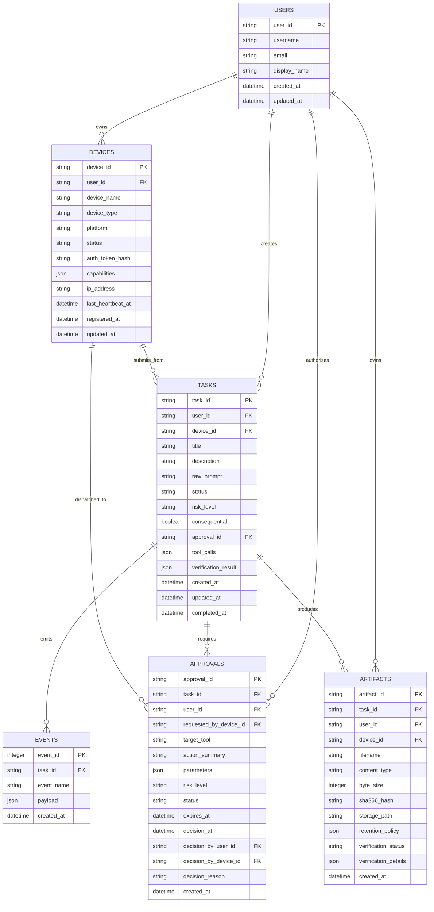

# Data Models & Schema Contracts

- **Document ID**: `MIRA-DOC-DAT-013`
- **Revision**: 1.1.0
- **Status**: Engineering Standard
- **Last Updated**: 2026-10-18

---

## 1. Overview & Data Architecture

MIRA maintains strict separation between **Human User Identity** and **Physical Device Identity**, aligning its persistent relational storage (**SQLite 3**) with its external interchange contracts (**JSON Schema Draft 2020-12**).

```
+--------------------------+          +--------------------------+
|  SQLite Relational DB    | <======> | JSON Schema Contracts    |
|  (ACID Storage & Audit)  |          | (REST & SSE Interchange) |
+--------------------------+          +--------------------------+
```

---

## 2. Relational Database Schema (SQLite)

The SQLite database file is located at `database/mira.db` with Write-Ahead Logging (`WAL`) mode enabled.



---

## 3. SQL Table Definitions (DDL)

```sql
-- Users Table (User Identity distinct from Device Identity)
CREATE TABLE IF NOT EXISTS users (
    user_id TEXT PRIMARY KEY,
    username TEXT NOT NULL UNIQUE,
    email TEXT NOT NULL UNIQUE,
    display_name TEXT NOT NULL,
    created_at DATETIME NOT NULL,
    updated_at DATETIME NOT NULL
);

-- Devices Table (Hardware Identity associated with a User)
CREATE TABLE IF NOT EXISTS devices (
    device_id TEXT PRIMARY KEY,
    user_id TEXT NOT NULL REFERENCES users(user_id),
    device_name TEXT NOT NULL,
    device_type TEXT NOT NULL CHECK(device_type IN ('phone_primary', 'windows_workstation', 'cloud_backend')),
    platform TEXT NOT NULL CHECK(platform IN ('android', 'ios', 'windows_11', 'linux_container')),
    status TEXT NOT NULL CHECK(status IN ('online', 'offline', 'paired', 'unpaired', 'suspended')),
    auth_token_hash TEXT NOT NULL,
    capabilities TEXT NOT NULL, -- JSON array of strings
    ip_address TEXT,
    last_heartbeat_at DATETIME,
    registered_at DATETIME NOT NULL,
    updated_at DATETIME NOT NULL
);
CREATE INDEX IF NOT EXISTS idx_devices_user ON devices(user_id);

-- Tasks Table
CREATE TABLE IF NOT EXISTS tasks (
    task_id TEXT PRIMARY KEY,
    user_id TEXT NOT NULL REFERENCES users(user_id),
    device_id TEXT NOT NULL REFERENCES devices(device_id),
    title TEXT NOT NULL,
    description TEXT,
    raw_prompt TEXT NOT NULL,
    status TEXT NOT NULL CHECK(status IN (
        'pending_confirmation', 'confirmed', 'validating', 'awaiting_approval',
        'approved', 'executing', 'verifying', 'completed', 'failed', 'rejected', 'cancelled'
    )),
    risk_level TEXT NOT NULL CHECK(risk_level IN ('low', 'medium', 'high', 'critical')),
    consequential BOOLEAN NOT NULL DEFAULT 0,
    approval_id TEXT REFERENCES approvals(approval_id),
    tool_calls TEXT,           -- JSON array of tool execution records
    verification_result TEXT,  -- JSON object detailing verification outcome
    created_at DATETIME NOT NULL,
    updated_at DATETIME NOT NULL,
    completed_at DATETIME
);
CREATE INDEX IF NOT EXISTS idx_tasks_status ON tasks(status);
CREATE INDEX IF NOT EXISTS idx_tasks_user ON tasks(user_id);
CREATE INDEX IF NOT EXISTS idx_tasks_device ON tasks(device_id);

-- Approvals Table
CREATE TABLE IF NOT EXISTS approvals (
    approval_id TEXT PRIMARY KEY,
    task_id TEXT NOT NULL REFERENCES tasks(task_id),
    user_id TEXT NOT NULL REFERENCES users(user_id),
    requested_by_device_id TEXT NOT NULL REFERENCES devices(device_id),
    target_tool TEXT NOT NULL,
    action_summary TEXT NOT NULL,
    parameters TEXT NOT NULL,  -- JSON snapshot of tool arguments
    risk_level TEXT NOT NULL CHECK(risk_level IN ('low', 'medium', 'high', 'critical')),
    status TEXT NOT NULL CHECK(status IN ('pending', 'approved', 'rejected', 'expired', 'revoked')),
    expires_at DATETIME NOT NULL,
    decision_at DATETIME,
    decision_by_user_id TEXT REFERENCES users(user_id),
    decision_by_device_id TEXT REFERENCES devices(device_id),
    decision_reason TEXT,
    created_at DATETIME NOT NULL
);
CREATE INDEX IF NOT EXISTS idx_approvals_task ON approvals(task_id);
CREATE INDEX IF NOT EXISTS idx_approvals_user ON approvals(user_id);
CREATE INDEX IF NOT EXISTS idx_approvals_status_expiry ON approvals(status, expires_at);

-- Artifacts Table
CREATE TABLE IF NOT EXISTS artifacts (
    artifact_id TEXT PRIMARY KEY,
    task_id TEXT NOT NULL REFERENCES tasks(task_id),
    user_id TEXT NOT NULL REFERENCES users(user_id),
    device_id TEXT NOT NULL REFERENCES devices(device_id),
    filename TEXT NOT NULL,
    content_type TEXT NOT NULL,
    byte_size INTEGER NOT NULL,
    sha256_hash TEXT NOT NULL,
    storage_path TEXT NOT NULL,
    retention_policy TEXT NOT NULL,     -- JSON object: tier, expiry
    verification_status TEXT NOT NULL CHECK(verification_status IN ('unverified', 'verified', 'failed')),
    verification_details TEXT,         -- JSON object with parser diagnostics
    created_at DATETIME NOT NULL
);
CREATE INDEX IF NOT EXISTS idx_artifacts_task ON artifacts(task_id);
CREATE INDEX IF NOT EXISTS idx_artifacts_user ON artifacts(user_id);

-- Events Table (Rolling Replay Log)
CREATE TABLE IF NOT EXISTS events (
    event_id INTEGER PRIMARY KEY AUTOINCREMENT,
    task_id TEXT REFERENCES tasks(task_id),
    event_name TEXT NOT NULL,
    payload TEXT NOT NULL,             -- JSON data payload
    created_at DATETIME NOT NULL
);
CREATE INDEX IF NOT EXISTS idx_events_task_id ON events(task_id);
```

---

## 4. JSON Schema Mapping Matrix

| Domain Entity | Relational Table | JSON Schema File | Dialect | Key Identifiers |
| :--- | :--- | :--- | :--- | :--- |
| User Entity | `users` | N/A (Internal Auth / JWT sub) | RFC 7519 | `user_id` |
| Device Entity | `devices` | [`schemas/device.schema.json`](../schemas/device.schema.json) | Draft 2020-12 | `device_id`, `user_id` |
| Task Object | `tasks` | [`schemas/task.schema.json`](../schemas/task.schema.json) | Draft 2020-12 | `task_id`, `user_id`, `device_id` |
| Approval Ticket | `approvals` | [`schemas/approval.schema.json`](../schemas/approval.schema.json) | Draft 2020-12 | `approval_id`, `task_id`, `user_id`, `requested_by_device_id` |
| Artifact Object | `artifacts` | [`schemas/artifact.schema.json`](../schemas/artifact.schema.json) | Draft 2020-12 | `artifact_id`, `task_id`, `user_id`, `device_id` |
