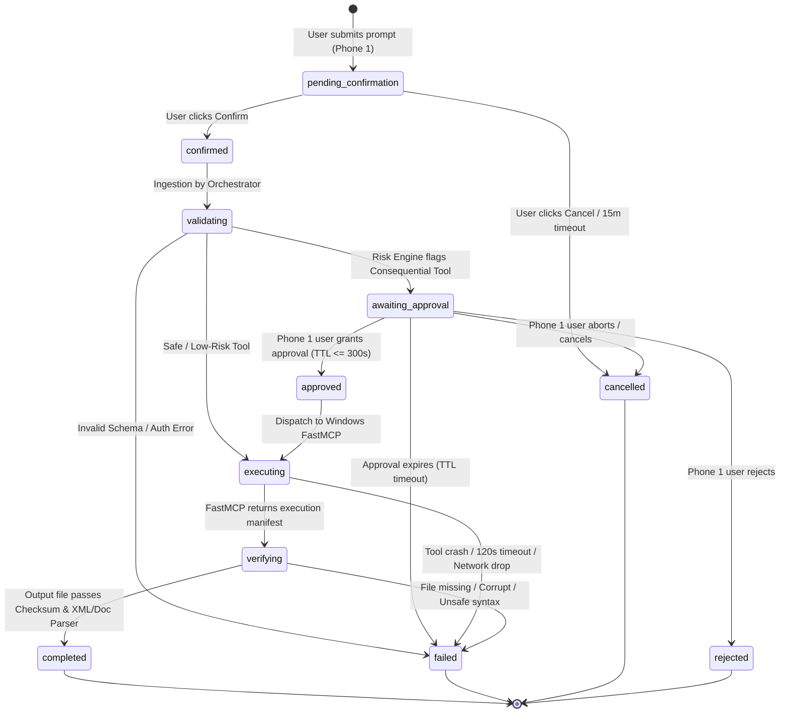

# Task Lifecycle & State Transitions

- **Document ID**: `MIRA-DOC-TSK-009`
- **Revision**: 1.1.0
- **Status**: Engineering Standard
- **Last Updated**: 2026-10-18

---

## 1. Lifecycle Overview & Architectural Philosophy

The MIRA Task Lifecycle controls the path from raw user intent on **Phone 1** to physical execution on the **Windows Laptop MCP Server**, concluding with rigorous output verification before completing.

### Golden Rules of Task State
1. **Single Mobile Endpoint**: Phone 1 is the sole primary user interface; no secondary companion phone or forwarding relay exists.
2. **Never Assume Success**: A tool returning an HTTP 200 is treated only as a hint to begin verification. The task remains in `verifying` until the artifact verification engine passes.
3. **Explicit Confirmation**: Every voice or text prompt must be parsed and visually presented to the user on Phone 1 for confirmation before execution begins.
4. **No Phantom Progress**: State updates and progress percentages stream in real-time over Server-Sent Events (SSE).

---

## 2. Complete State Diagram

---

## 3. Step-by-Step Transition Protocol

### Stage 1: Ingestion & Interpretation (`pending_confirmation`)
- **Action**: Phone 1 POSTs `raw_prompt`, `user_id`, and `device_id` to `/api/tasks`.
- **System**: Flask intent parser extracts title and parameters.
- **Record**: Task inserted into SQLite with status `pending_confirmation`.
- **UI**: Phone 1 displays the task interpretation card with an action button: *"Confirm Plan"*.

### Stage 2: User Confirmation (`confirmed`)
- **Action**: User reviews the interpretation on Phone 1 and taps "Confirm".
- **API Call**: POST `/api/tasks/{task_id}/confirm`.
- **System**: Status moves to `confirmed`.

### Stage 3: Policy Evaluation (`validating`)
- **System**: Policy engine analyzes the mapped MCP tool.
- **Branching**:
  - If `risk_level == 'low'`: Immediately transitions to `executing`.
  - If `risk_level in ['medium', 'high']`: Constructs an approval ticket adhering to `schemas/approval.schema.json` and moves task to `awaiting_approval`.

### Stage 4: Consequential Approval Gate (`awaiting_approval` -> `approved`)
- **UI**: Phone 1 triggers the Approval Modal with an active countdown timer (180s).
- **Outcome A (Approved)**: User taps "Authorize Action". State moves to `approved` then `executing`.
- **Outcome B (Rejected)**: User taps "Deny". State moves to terminal `rejected`.
- **Outcome C (Cancelled)**: User aborts before timer expires. State moves to `cancelled`.
- **Outcome D (Timeout)**: 180s elapses. State moves to `failed` (`APPROVAL_EXPIRED`).

### Stage 5: Workstation Execution (`executing`)
- **System**: Backend MCP client issues `tools/call` over Streamable HTTP to `http://<laptop-ip>:8000/mcp`.
- **Telemetry**: Laptop streams execution progress (`task:progress`) via SSE to Phone 1.
- **Manifest**: Laptop produces output in `C:\mira\workspace\` and returns file metadata + SHA-256 hash.
- **Transition**: State moves to `verifying`.

### Stage 6: Physical File Verification (`verifying`)
- **System**: Backend pulls the raw file from the laptop via the internal transfer route.
- **Probes**:
  1. Computes SHA-256; compares with manifest.
  2. Runs deep structural probe (XML parser for SVG, header check for PDF).
  3. Scans for security violations (`<script>` injection).
- **Branching**:
  - If all probes pass: Backend saves artifact to container storage, records `verification_result.verified = true`, and sets status to `completed`.
  - If any probe fails: Status set to `failed` (`VERIFICATION_FAILED`).

### Stage 7: Delivery & Presentation (`completed`)
- **UI**: Phone 1 receives event `task:completed` with `artifact_id`.
- **Display**: Phone 1 fetches the verified asset via authenticated route and renders it in full resolution with pan/zoom.

---

## 4. Timeout & Recovery Rules

| Scenario | Timeout | Resolution |
| :--- | :--- | :--- |
| User Confirmation Inactivity | 15 minutes | Status moves to `cancelled`. |
| Approval Window Inactivity | 180 seconds | Status moves to `failed` (`APPROVAL_EXPIRED`). |
| Windows MCP RPC Latency | 120 seconds | Process terminated; status moves to `failed` (`TOOL_TIMEOUT`). |
| Artifact Verification Latency | 15 seconds | Status moves to `failed` (`VERIFICATION_TIMEOUT`). |
