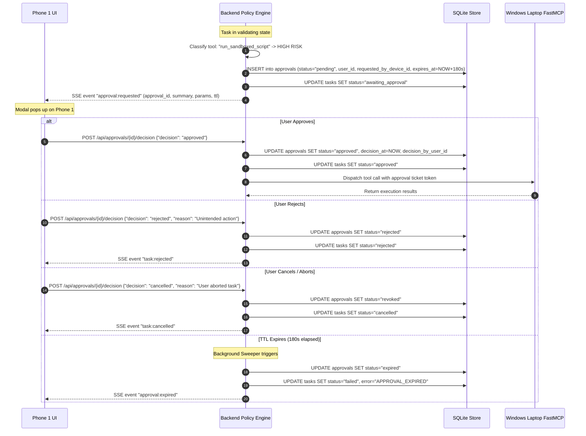

# Protocol Specification: Consequential Action Approval Flow

- **Protocol Identifier**: `MIRA-PROTO-APPR-003`
- **Revision**: 1.1.0
- **Status**: Stable / Specification
- **Last Verified**: 2026-10-18
- **Applies To**: Phone 1 (Approving Agent), MIRA Policy Engine, Windows Laptop FastMCP Server

---

## 1. Objectives & Threat Model

The Approval Flow guarantees that **no consequential or state-mutating operation** executes on the user's Windows workstation without explicit, informed, and cryptographic authorization from **Phone 1**.

### Threat Mitigations
- **Autonomous Agent Drift**: Prevents language models or autonomous loops from executing destructive file mutations, shell commands, or confidential data exports without human oversight.
- **Prompt Injection Attacks**: An adversarial prompt attempting to trigger file deletion or malicious script execution is intercepted at the policy layer and quarantined pending user sign-off.
- **Stale Authorizations**: Time-To-Live (TTL) enforcement prevents delayed execution of permissions granted under different environmental contexts.
- **Identity Distinction**: Ensures approvals are cryptographically bound to the authenticated `user_id` as well as the authorized `requested_by_device_id` (Phone 1).

---

## 2. Risk Classification Framework

Before any FastMCP tool invocation is scheduled, the MIRA Policy Engine classifies the target tool and its evaluated parameters:

| Risk Level | Classification | Criteria | Action Required |
| :--- | :--- | :--- | :--- |
| **Low** | Non-consequential | Read-only inspection within sandbox, SVG generation into isolated workspace temp folder. | Automatic execution; no approval prompt. |
| **Medium** | Moderately Consequential | Modifying non-critical project documents, writing files to user-specified target folders, large data exports. | **Mandatory Phone 1 Approval (TTL: 300s)** |
| **High** | Highly Consequential | Executing shell scripts, installing python packages, network egress to external endpoints, modifying workspace configurations. | **Mandatory Phone 1 Approval with biometric / PIN re-auth (TTL: 180s)** |
| **Critical** | Prohibited | Deleting directories outside sandbox, accessing system credentials, modifying Windows registry, raw disk formatting. | **Hard Block (System Policy Rejection)**; never permitted. |

---

## 3. Protocol Sequence: Approval Request & Decision



---

## 4. Approval Envelope Specification

When an approval is required, the backend constructs an approval record conforming strictly to `schemas/approval.schema.json`:

```json
{
  "approval_id": "8f3b2c91-4d1a-4f5e-9a22-9871c564e9a1",
  "task_id": "c1a93b44-93e1-4c44-b0e9-b541306ef456",
  "user_id": "11111111-2222-4333-8444-555555555555",
  "requested_by_device_id": "7b8e1a22-5501-4963-8888-000000000001",
  "target_tool": "run_sandboxed_script",
  "action_summary": "Run Python script 'build_report.py' in project workspace with arguments: --format svg",
  "parameters": {
    "script_name": "build_report.py",
    "timeout_seconds": 60,
    "arguments": ["--format", "svg"]
  },
  "risk_level": "high",
  "status": "pending",
  "expires_at": "2026-10-18T12:05:00Z",
  "decision_at": null,
  "decision_by_user_id": null,
  "decision_by_device_id": null,
  "decision_reason": null,
  "created_at": "2026-10-18T12:02:00Z"
}
```

### Presentation on Phone 1
Phone 1 displays the **ApprovalDialog** component with:
1. Prominent hazard banner colored by risk level (Amber for Medium, Crimson for High).
2. Human-readable action summary.
3. Collapsible parameter inspector showing exact file names and arguments.
4. Active visual countdown timer derived from `expires_at`.
5. Three explicit action choices: **"Deny Action"**, **"Cancel Task"**, and **"Authorize Action"**.

---

## 5. Revocation & Enforcement Invariants

1. **One-Time Use Token**: Each approval is cryptographically single-use. Once an approved tool call completes or fails, the approval ticket is retired and cannot be reused for subsequent tool calls.
2. **Instant Revocation & Cancellation**: If the user taps "Cancel" or "Revoke" on Phone 1 while the tool is queued, the backend immediately marks the approval `revoked`, marks the task `cancelled`, and rejects any pending MCP invocation.
3. **No Retroactive Clearances**: An approval granted for `generate_svg_poster` does not grant permissions for any secondary tool, even within the same parent task.
4. **Audit Immutability**: All decisions (`approved`, `rejected`, `expired`, `revoked`), timestamps, `decision_by_user_id`, and `decision_by_device_id` are permanently appended to the SQLite audit log.
