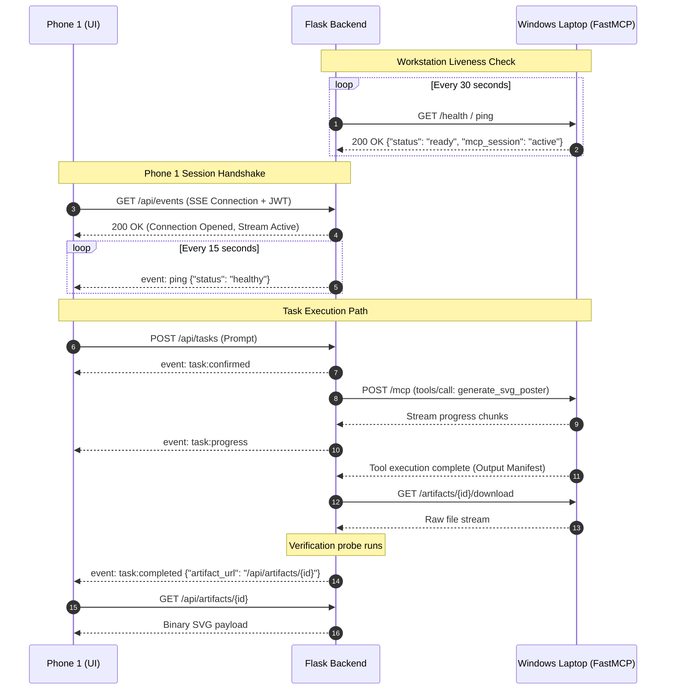

# Protocol Specification: Device Connection & Networking

- **Protocol Identifier**: `MIRA-PROTO-CONN-002`
- **Revision**: 1.1.0
- **Status**: Stable / Specification
- **Last Verified**: 2026-10-18
- **Applies To**: Phone 1 (Primary Mobile Client), MIRA Backend, Windows Laptop FastMCP Server

---

## 1. Network Topology & Roles

MIRA enforces a strict tripartite network topology with clear perimeter boundaries.

```
       +---------------------------------------------+
       |                  Phone 1                    |
       |  (Primary Mobile Device / React + Vite PWA) |
       +---------------------------------------------+
                              |
                     HTTPS / WSS / SSE
                     (Bearer JWT Auth)
                              |
                              v
       +---------------------------------------------+
       |             MIRA Flask Backend              |
       |  (Containerized Orchestrator & MCP Client)  |
       +---------------------------------------------+
                              |
                    Streamable HTTP (MCP)
                    (Shared Secret / mTLS)
                              |
                              v
       +---------------------------------------------+
       |         Windows Laptop MCP Server           |
       |     (Native FastMCP / Uvicorn Service)      |
       +---------------------------------------------+
```

### Explicit Role Definitions
1. **Phone 1 (`phone_primary`)**: The sole primary user interaction terminal. Issues tasks, displays confirmation dialogues, grants high-risk approvals, and renders verified artifacts. No secondary companion phone or forwarding relay exists.
2. **MIRA Backend (`cloud_backend`)**: Central API gateway, state machine coordinator, policy engine, and MCP Client. Mediates all access.
3. **Windows Laptop (`windows_workstation`)**: Hosts the FastMCP execution engine. Executes authorized workstation tools in sandboxed workspaces. **Never directly exposed to Phone 1.**
4. **No Companion Phone Relay**: All interactions take place directly between Phone 1 and the MIRA Backend.

---

## 2. Authentication & Identity Models

Every endpoint connecting to the MIRA ecosystem must be registered and authenticated according to `schemas/device.schema.json`.

### A. Phone 1 to Flask Backend
- **Transport**: TLS 1.3 over HTTPS and Server-Sent Events (SSE).
- **Authentication**: Cryptographic Bearer Token (JWT).
  - Header: `Authorization: Bearer <jwt-token>`
  - Claims:
    - `sub`: User ID (`user_id` UUIDv4)
    - `dev_id`: Phone 1 Device ID (`device_id` UUIDv4)
    - `role`: `phone_primary`
    - `caps`: `["task:submit", "task:read", "approval:grant", "artifact:read"]`
    - `exp`: 24 hours from issuance.
- **Pairing Ceremony**:
  1. User navigates to MIRA Web App on Phone 1.
  2. Initiates one-time QR Code or 6-digit numeric pairing PIN generated by MIRA admin CLI.
  3. Phone 1 exchanges pairing secret at `/api/auth/pair` for long-lived refresh token and session JWT.
  4. Device record created in SQLite with status `paired` and associated `user_id`.

### B. Flask Backend (MCP Client) to Windows Laptop (MCP Server)
- **Transport**: Streamable HTTP over local network or secure tunnel (e.g. Tailscale / WireGuard / HTTPS reverse proxy).
- **Authentication**: Mutual Pre-Shared Key (PSK) or mTLS Client Certificate.
  - Header: `X-MIRA-MCP-Key: <high-entropy-64-byte-token>`
  - Timestamp validation: `X-MIRA-Timestamp: <iso8601>` (enforces +/- 30s clock drift prevention).
  - Signature: `X-MIRA-Signature: HMAC-SHA256(key, timestamp + method + body)`.
- **Zero Raw Filesystem Access**: The MCP server never exposes arbitrary disk read/write APIs. All tool interactions are bounded by explicit functional contracts (`generate_svg_poster`, `build_document`, etc.) inside a confined workspace directory (`C:\mira\workspace\`).

---

## 3. Communication Protocols

### A. Real-Time Telemetry: Phone 1 <-> Backend
- **Endpoint**: `GET /api/events`
- **Format**: Server-Sent Events (SSE) `text/event-stream`
- **Reconnection**: Supports standard `Last-Event-ID` header. If network disconnects, client automatically reconnects and receives backpressure queue of missed task transitions.
- **Heartbeat**: Ping event dispatched every 15 seconds:
  ```http
  event: ping
  data: {"timestamp": "2026-10-18T12:00:00Z"}
  ```

### B. FastMCP RPC: Backend (Client) <-> Windows Laptop (Server)
- **Endpoint**: `POST /mcp` (Streamable HTTP / SSE transport supported by modern FastMCP and Python MCP SDK).
- **Protocol**: JSON-RPC 2.0 over HTTP. Target specification: MCP `2025-11-25` or later.
- **Session Handshake**:
  1. Backend issues `initialize` request with client capabilities.
  2. Laptop FastMCP server replies with tool registry:
     - `list_tools`: Returns schemas for available tools (`generate_svg_poster`, `export_telemetry`, etc.).
  3. Backend acknowledges with `notifications/initialized`.
- **Tool Call Execution**:
  - Request: `tools/call` with tool name and structured arguments.
  - Streaming output: FastMCP streams tool logs and execution percentage back to Flask.
  - Final Result: Structured JSON payload with output file descriptor and SHA-256 hash.

---

## 4. Connection Lifecycle & Health Probing



---

## 5. Network Failure Modes & Fault Tolerance

1. **Windows Laptop Offline**:
   - Backend detects laptop disconnection via health probe failure.
   - Any new task requiring laptop tools returns HTTP 503 (`WORKSTATION_OFFLINE`) to Phone 1 with actionable advisory: *"Windows MCP Server is unreachable. Please verify Uvicorn is running on your laptop."*
2. **Phone 1 Network Drop**:
   - Backend buffers event messages for 10 minutes in memory/SQLite.
   - When Phone 1 regains cellular/Wi-Fi connection, it connects with `Last-Event-ID` and consumes buffered events without losing execution progress.
3. **Session Token Expiry**:
   - If Phone 1 token expires mid-operation, the SSE stream disconnects with HTTP 401. Phone 1 performs silent token refresh using HTTP-only cookie or refresh token, re-establishing the SSE session immediately.
