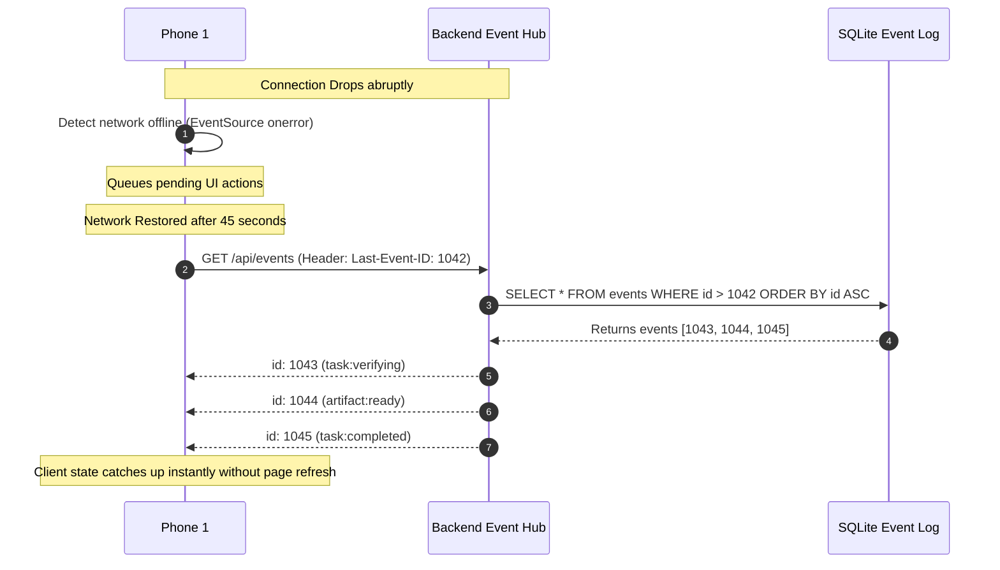

# Protocol Specification: Realtime Event Streaming & Synchronization

- **Protocol Identifier**: `MIRA-PROTO-EVNT-005`
- **Revision**: 1.1.0
- **Status**: Stable / Specification
- **Last Verified**: 2026-10-18
- **Applies To**: Phone 1 Client, MIRA Flask Backend (Event Hub)

---

## 1. Architecture & Transport Overview

To maintain instantaneous synchronization without the battery drain and overhead of repeated polling, MIRA utilizes **Server-Sent Events (SSE)** compliant with HTML5 EventSource standards over an HTTP/2 or HTTP/1.1 TLS connection.

```
[Phone 1 Web Client] <=================== SSE Stream =================== [Flask Event Hub]
                     (GET /api/events with Bearer Token & Last-Event-ID)
```

---

## 2. Event Registry & Payload Schemas

Every event streamed across the wire contains an auto-incrementing, globally monotonic `id`, an `event` name, and a JSON `data` object:

```http
id: 1042
event: task:progress
data: {"task_id":"c1a93b44-93e1-4c44-b0e9-b541306ef456","progress_percent":65,"stage":"rendering_svg_elements","timestamp":"2026-10-18T12:10:05Z"}
```

### Complete Event Catalog

| Event Name | Trigger Condition | Primary Data Fields |
| :--- | :--- | :--- |
| `ping` | Periodic heartbeat (every 15s) | `timestamp`, `active_tasks_count` |
| `task:created` | Task submitted and parsed | `task_id`, `user_id`, `title`, `status="pending_confirmation"` |
| `task:confirmed` | User confirmed interpretation | `task_id`, `status="confirmed"` |
| `task:progress` | Incremental work from laptop | `task_id`, `progress_percent`, `stage_description` |
| `approval:requested`| Consequential tool requires sign-off | `approval_id`, `task_id`, `user_id`, `summary`, `risk_level`, `expires_at` |
| `approval:resolved` | Approval approved/rejected/expired/revoked | `approval_id`, `status`, `decision` |
| `task:verifying` | MCP tool done; verification running | `task_id`, `status="verifying"`, `verifier_type` |
| `task:completed` | Output verified; task complete | `task_id`, `status="completed"`, `artifact_id`, `completed_at` |
| `task:failed` | Any lifecycle failure or timeout | `task_id`, `status="failed"`, `error_code`, `message` |
| `artifact:ready` | Verified file available for download | `artifact_id`, `task_id`, `filename`, `download_url`, `byte_size` |

---

## 3. De-duplication & Idempotency Rules

Mobile networks frequently flap, drop packets, or retry connections. To protect the client state from corrupted transitions or repeated toast notifications:

1. **Monotonic Event IDs**: Every event has a strictly increasing sequence integer (`id: 1042`). Phone 1 tracks `lastProcessedId`. If an event with `id <= lastProcessedId` arrives, it is discarded immediately.
2. **State Idempotency**: State update handlers in `AppContext.jsx` match by `task_id`. Receiving a duplicate `task:confirmed` event for a task already in `executing` is a no-op.
3. **Transaction Keys**: Outbound mutations from Phone 1 (e.g., approving a task) send a client-generated UUID `idempotency_key`. Multiple submissions with the same key execute the authorization logic exactly once.

---

## 4. Reconnection, Buffer Replay & Recovery

When Phone 1 loses cellular or Wi-Fi connectivity:



### Buffer Policy
- The backend retains a rolling event buffer in SQLite (minimum 1,000 events or 1 hour of retention).
- If Phone 1 has been disconnected for longer than the event buffer window, the backend responds with event `session:reset_required`. Phone 1 then makes a full REST state synchronization call (`GET /api/tasks?active=true`) and re-subscribes.
