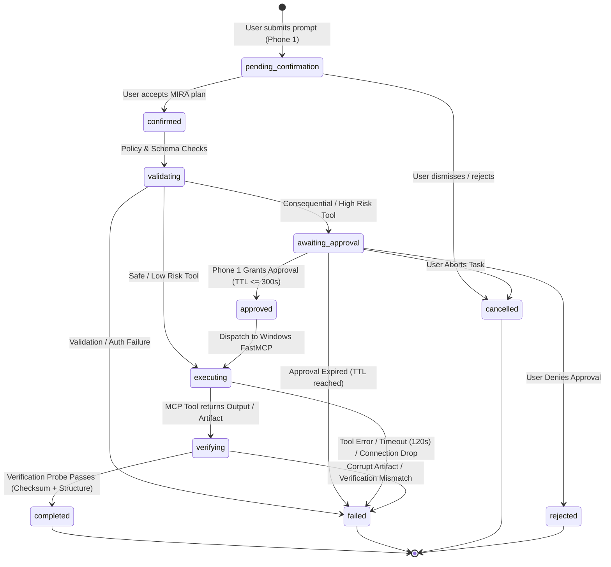

# Protocol Specification: Task Lifecycle

- **Protocol Identifier**: `MIRA-PROTO-TASK-001`
- **Revision**: 1.1.0
- **Status**: Stable / Specification
- **Last Verified**: 2026-10-18
- **Applies To**: Phone 1 (Client UI), MIRA Flask Backend (Agent Orchestrator), Windows Laptop MCP Server (Workstation Execution Engine)

---

## 1. Overview & Architectural Boundaries

The MIRA Task Lifecycle governs the complete lifecycle of a request from voice or text ingestion on **Phone 1** to execution on the **Windows Laptop MCP Server** and artifact verification before final completion. 

The architecture strictly operates under the directional pipeline:
```
[Phone 1] ---> [MIRA Flask Backend / Orchestrator] ---> [Windows Laptop FastMCP Server]
     ^                                                                |
     |                                                                |
     +--- (Verified Artifacts & Realtime Telemetry SSE Stream) <------+
```

### Core Design Principles
1. **Single Mobile Endpoint**: Phone 1 is the sole primary user interface; no secondary companion phone or forwarding relay exists.
2. **Zero Blind Trust**: A tool returning an HTTP 200 or an MCP success object does **not** signify task completion.
3. **Explicit Verification Gate**: A task can only reach `completed` status if physical file verification (checksum, structural integrity, schema) passes.
4. **Dual Confirmation for Consequential Ops**: High-risk or state-altering actions mandate an explicit, time-bounded approval token from Phone 1 before MCP dispatch.
5. **Resilient State Persistence**: Every state transition is written to SQLite before external network calls are dispatched.

---

## 2. Finite State Machine (FSM)

The task lifecycle progresses through distinct linear and branching states.



### Complete State Registry

| State | Classification | Description | Allowed Next States |
| :--- | :--- | :--- | :--- |
| `pending_confirmation` | Transient / User Wait | MIRA parsed raw input; displays interpretation title & steps on Phone 1 for consent. | `confirmed`, `cancelled` |
| `confirmed` | Operational | User tapped "Confirm" on Phone 1. Backend prepares task envelope. | `validating`, `cancelled` |
| `validating` | Operational | Backend checks user token, device capabilities, rate limits, schema syntax, and risk level. | `awaiting_approval`, `executing`, `failed` |
| `awaiting_approval` | Blocking / Security Gate | Task requires consequential access; approval request published to Phone 1. | `approved`, `rejected`, `cancelled`, `failed` |
| `approved` | Operational | Valid approval token verified; backend unlocks MCP client dispatch. | `executing`, `cancelled` |
| `executing` | Remote RPC | FastMCP client calls tool via Streamable HTTP on Windows laptop. | `verifying`, `failed` |
| `verifying` | Mandatory Quality Gate | Backend runs structural parser & checksum validator on laptop output. | `completed`, `failed` |
| `completed` | Terminal / Success | Output verified; artifact registered; Phone 1 displays real asset. | None |
| `failed` | Terminal / Error | Execution, validation, verification, or timeout error recorded. | None |
| `rejected` | Terminal / User Denied | Consequential approval was rejected by Phone 1 user. | None |
| `cancelled` | Terminal / Aborted | User terminated task prior to execution. | None |

---

## 3. Protocol Execution Stages

### Stage 1: Submission & Interpretation (`pending_confirmation` -> `confirmed`)
1. **Ingestion**: Phone 1 POSTs `{"raw_prompt": "Create an SVG poster for TechFest 2026", "user_id": "<uuid>", "device_id": "<uuid>"}` to `/api/tasks`.
2. **Intent Parsing**: Backend parses prompt using intent analyzer, generates a clear `title` ("Generate TechFest 2026 Vector Poster") and descriptive execution steps.
3. **Confirmation Envelope**: Backend persists task record with status `pending_confirmation` and returns the envelope to Phone 1.
4. **User Action**: Phone 1 displays the interpretation card. The user must press "Confirm" or "Edit".
5. **State Move**: If user clicks Confirm, Phone 1 sends POST `/api/tasks/{id}/confirm`, moving state to `confirmed`.

### Stage 2: Validation & Policy Engine (`confirmed` -> `validating`)
1. **Device & User Integrity**: Backend verifies `user_id` and `device_id` against `schemas/device.schema.json` and ensures `capabilities` contains `task:submit`.
2. **Risk Assessment**: The policy engine evaluates candidate MCP tools against security policies:
   - **Low Risk (Read-only, sandboxed generation)**: Direct execution allowed.
   - **Consequential (File writes outside temp, script execution, system queries)**: Triggers `awaiting_approval`.
3. **State Move**: Task transitions to `awaiting_approval` (if consequential) or `executing`.

### Stage 3: Approval Gating (`awaiting_approval` -> `approved`)
1. **Approval Ticket**: Backend generates an entry adhering to `schemas/approval.schema.json` with a mandatory TTL (default: 180 seconds, max: 300 seconds).
2. **Realtime Push**: SSE event `approval:requested` pushed to Phone 1.
3. **User Decision**: Phone 1 user reviews parameters and taps "Approve" (or "Reject" / "Cancel").
4. **Resolution**:
   - If approved within TTL, state moves to `approved` then immediately `executing`.
   - If rejected, moves to `rejected`.
   - If user cancels, moves to `cancelled`.
   - If time reaches `expires_at`, background sweeper transitions task to `failed` with error `APPROVAL_TIMEOUT`.

### Stage 4: MCP Execution (`executing` -> `verifying`)
1. **Session Setup**: Flask backend opens a Streamable HTTP session to `http://<laptop-ip>:8000/mcp`.
2. **Tool Dispatch**: Backend invokes the selected FastMCP tool (`tools/call`) with sanitized JSON arguments.
3. **Execution Heartbeats**: The Windows laptop streams progress events over SSE (`task:progress`).
4. **Output Manifest**: Upon finishing, the laptop returns a structured JSON result:
   ```json
   {
     "status": "success",
     "output_type": "artifact",
     "artifact": {
       "filename": "techfest_2026.svg",
       "content_type": "image/svg+xml",
       "byte_size": 24810,
       "sha256": "e3b0c44298fc1c149afbf4c8996fb92427ae41e4649b934ca495991b7852b855",
       "temp_path": "C:\\mira\\workspace\\techfest_2026.svg"
     }
   }
   ```
5. **State Move**: Task transitions to `verifying`.

### Stage 5: Mandatory Verification Gate (`verifying` -> `completed` / `failed`)
1. **Download & Checksum**: The backend fetches the raw file from the laptop via the secure artifact protocol and computes SHA-256. If checksum != manifest SHA-256, verification **FAILS**.
2. **Deep Semantic Verification**:
   - For **SVG**: Validates XML structure, checks for `<svg>` root, enforces viewBox, blocks dangerous tags (`<script>`, `<foreignObject>`).
   - For **Documents/JSON**: Validates against target schema or PDF header (`%PDF-`).
3. **Outcome**:
   - If verification succeeds: Backend updates `verification_result = {"verified": true, ...}`, saves file to artifact storage, and sets status to `completed`.
   - If verification fails: Status set to `failed` with diagnostic `VERIFICATION_FAILED`. Task is NEVER marked complete.

---

## 4. Timeout & Error Recovery Specifications

### Timeout Thresholds

| Operation | Timeout | Action on Expiry |
| :--- | :--- | :--- |
| User Confirmation | 15 minutes | Transitions to `cancelled`. |
| Consequential Approval | 300 seconds (5 min) | Transitions to `failed` (`APPROVAL_TIMEOUT`). |
| Windows MCP Connect | 10 seconds | Retries 2x; transitions to `failed` (`MCP_HOST_UNREACHABLE`). |
| Tool Execution | 120 seconds | Cancels MCP session; transitions to `failed` (`TOOL_TIMEOUT`). |
| Artifact Verification | 15 seconds | Transitions to `failed` (`VERIFICATION_TIMEOUT`). |

### Crash & Network Disconnect Recovery
- **Backend Restart**: On backend boot, any tasks in `executing` state are inspected. If the MCP server confirms the process died or disconnected, task is moved to `failed` with code `HOST_DISCONNECT_RECOVERY`.
- **Phone 1 Reconnect**: When Phone 1 client reconnects, it queries `GET /api/tasks?active=true` and subscribes to `/api/events` with `Last-Event-ID` to replay missed state changes.

---

## 5. Security & Safety Invariants
- Invariant 1: **No Execution Without Confirmation**: Unconfirmed tasks cannot dispatch tools.
- Invariant 2: **Approval Non-Transferability**: Approval tickets are cryptographically bound to the initiating `user_id`, `device_id` (Phone 1), and target `task_id`.
- Invariant 3: **Verification Precedence**: `completed_at` timestamp MUST be greater than or equal to `verification_result.verified_at`.
